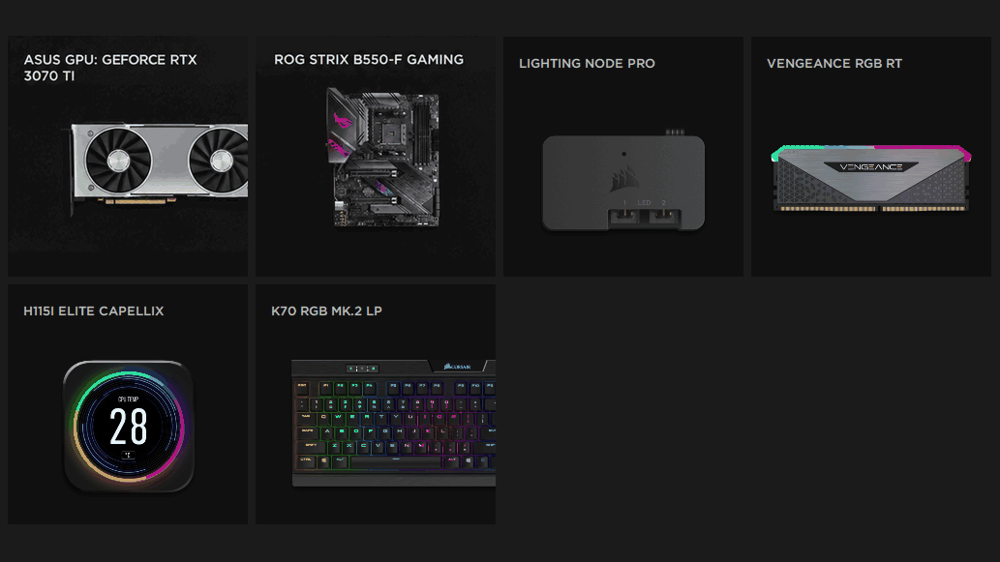
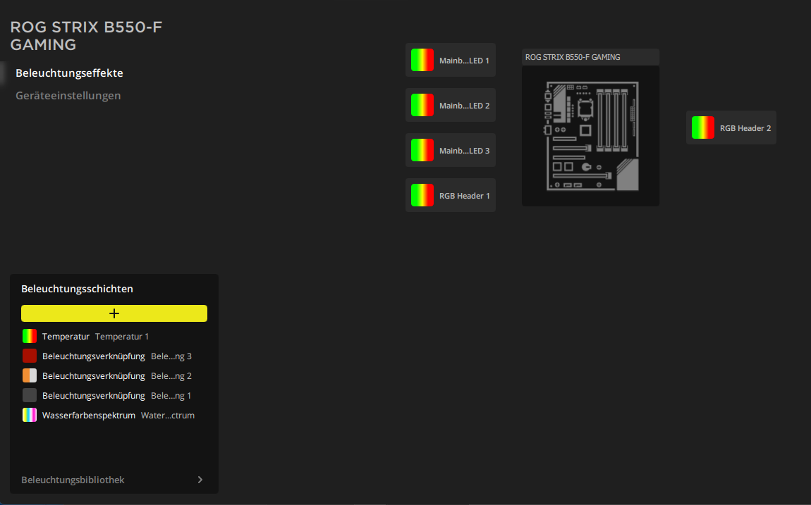
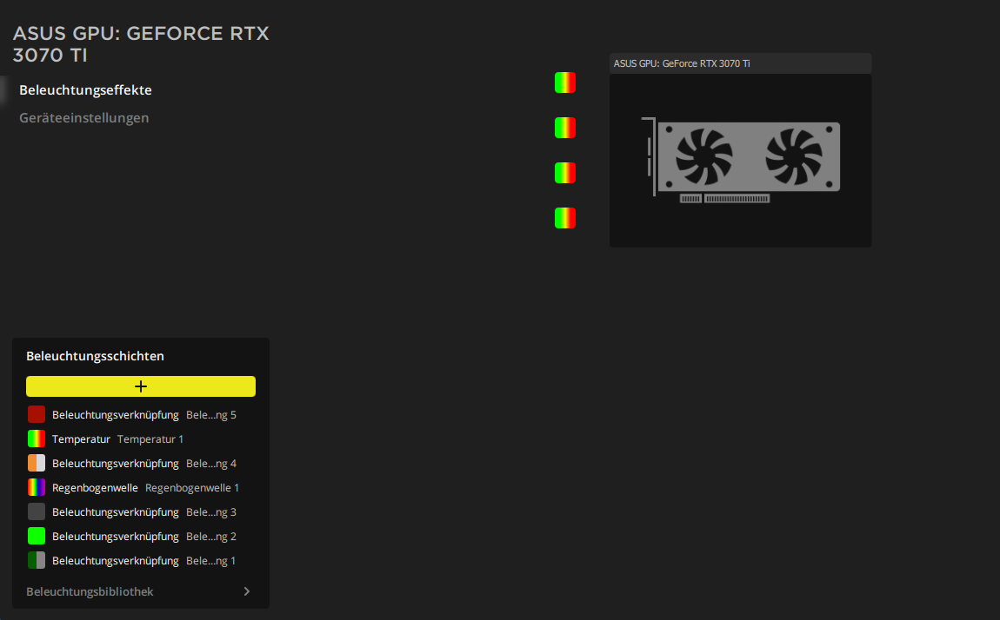

# IcueAuraBridge – ASUS Aura RGB in Corsair iCUE, ohne Armoury Crate <a href="README.md"></a><a href="README.de.md"></a>

**Integriere ASUS-Mainboards und -Grafikkarten in iCUE, ohne Armoury Crate. So easy.**

<p align="center"> <a href="https://github.com/Hendrik4K/IcueAuraBridge/releases/latest"></a>   <a href="LICENSE"></a></p>

<p align="center"></p>

iCUE bringt schon ein ASUS-Plugin mit, will dafür aber Armoury Crate im Hintergrund sehen. IcueAuraBridge ist genau das eine fehlende Teil: eine kleine DLL, die sich iCUE gegenüber als ASUS Aura SDK ausgibt und die Hardware direkt über USB und den NVIDIA-Treiber ansteuert. Keine Zusatz-App, kein Tray-Symbol, kein Hintergrunddienst und keine ASUS-Software. Mainboard und Grafikkarte tauchen als ganz normale Kacheln in iCUE auf und synchronisieren mit deinen Corsair-Geräten.

**⬇ [Download für Windows](https://github.com/Hendrik4K/IcueAuraBridge/releases/latest)** (kostenlos, GPL-2.0)

> **Beta.** Bisher getestet mit ROG STRIX B550-F GAMING + ASUS TUF RTX 3070 Ti. Rückmeldungen zu anderen Boards und Karten sind sehr willkommen: einfach ein Issue mit deiner `bridge.log` aufmachen.

<details>
<summary><b>🚀 Schnellstart</b></summary>

1. **Hardware prüfen** (siehe **Voraussetzungen**).
2. **Armoury Crate entfernen** mit dem *Armoury Crate Uninstall Tool* von der ASUS-Supportseite, danach neu starten. Armoury Crate und ASUS LightingService belegen dieselbe Schnittstelle wie die Bridge, beide gleichzeitig geht nicht.
3. **`IcueAuraBridge-<version>.zip`** unter **Releases** (rechts) herunterladen und **entpacken**. Nicht direkt aus dem Zip starten.
4. **`install.ps1`** per Rechtsklick → **Mit PowerShell ausführen**, oder im Terminal in diesem Ordner:

   ```powershell
   powershell -ExecutionPolicy Bypass -File .\install.ps1
   ```

   Admin-Abfrage bestätigen. Ein zweites Fenster läuft kurz durch, danach steht da:

   ```
   IcueAuraBridge: stopping iCUE and its plugin host
   IcueAuraBridge: installed 1.0.0.0 to C:\Program Files\IcueAuraBridge\IcueAuraBridge.dll
   IcueAuraBridge: log and settings in C:\ProgramData\IcueAuraBridge
   IcueAuraBridge: starting iCUE again
   ```

5. **iCUE startet von selbst neu.** Nach ein paar Sekunden zeigt der Startbildschirm das Mainboard unter seinem Modellnamen und die Grafikkarte als **ASUS GPU: …**.
6. **Kachel anklicken → Beleuchtungseffekte.** Jede LED ist einzeln steuerbar, mit allen iCUE-Ebenen: Effekte, Beleuchtungsverknüpfung mit deinen Corsair-Geräten, Temperaturfarben, Murals. Fertig.

**Du bist ein entspannter Typ oder ein entspanntes Girl?** Dann gib einfach diesen Prompt an deinen KI-Agenten (z. B. Claude Code oder Codex auf deinem PC). Er prüft deine Hardware, findet Armoury-Crate-Reste und fragt dich bei allem, was er ändern will.

```text
Hilf mir, IcueAuraBridge (github.com/Hendrik4K/IcueAuraBridge) auf diesem Windows-PC einzurichten, damit Corsair iCUE die RGB-Beleuchtung meines ASUS-Mainboards und/oder meiner ASUS-Grafikkarte steuert, ohne Armoury Crate.
Prüfe zuerst nur und frag mich vor jeder Änderung:
1. Windows 10/11 64 Bit und Corsair iCUE 4 installiert (Dienst `iCUEDevicePluginHost`, Ordner `plugins\ASUS` im iCUE-Verzeichnis)?
2. Mainboard: Gibt es einen „AURA LED Controller“ mit VID_0B05 und PID 18F3, 1939, 19AF, 1AA6 oder 1BED (`Get-PnpDevice -PresentOnly`)?
3. Grafikkarte: Lies die PNPDeviceID aus (`Get-CimInstance Win32_VideoController`) und gleiche Geräte-ID und ASUS-Subsystem mit `src/GpuList.cs` im Repo ab. Sag mir, was davon unterstützt wird.
4. Ist Armoury Crate oder ASUS LightingService installiert oder `aura.sdk.1` schon registriert? Wenn ja, erklär mir, wie ich es mit dem „Armoury Crate Uninstall Tool“ von ASUS entferne. Deinstalliere nichts selbst.
5. Lade das Zip aus dem neuesten GitHub-Release, entpacke es in einen eigenen Ordner, fass mir kurz zusammen, was `install.ps1` tut, und starte es erst nach meinem OK. Die Admin-Abfrage bestätige ich selbst.
6. Lies danach `C:\ProgramData\IcueAuraBridge\bridge.log` und sag mir, welche Geräte gefunden wurden und wo ich sie in iCUE finde.
7. Frag mich, ob an den ARGB-Headern des Mainboards LED-Streifen oder Lüfter hängen. Wenn ja, trag nach meinem OK die LED-Anzahl in `C:\ProgramData\IcueAuraBridge\config.ini` ein (z. B. `argb_header_1_leds = 30`) und starte iCUE neu.
```

**Deinstallieren:**

```powershell
powershell -ExecutionPolicy Bypass -File .\install.ps1 -Uninstall
```

Entfernt DLL und Registrierung und startet iCUE neu. `C:\ProgramData\IcueAuraBridge` (Einstellungen und Log) bleibt liegen, den Ordner kannst du selbst löschen.

</details>

<details open>
<summary><b>💡 Was es kann</b></summary>

- **ASUS-RGB direkt in iCUE**<br>Mainboard und Grafikkarte erscheinen als eigene Geräte neben deiner Corsair-Hardware.
- **Jede LED einzeln**<br>Onboard-LEDs, beide 12-V-RGB-Header und die LEDs der Grafikkarte, jeweils mit allen Beleuchtungsebenen von iCUE.
- **Sync mit Corsair**<br>Über die Beleuchtungsverknüpfung läuft alles im Gleichtakt, inklusive Temperaturfarben und Murals.
- **Kein zweiter RGB-Stack**<br>Kein Armoury Crate, kein OpenRGB oder SignalRGB, die sich mit iCUE um dieselbe Hardware streiten.
- **Unsichtbar**<br>Keine App, kein Tray-Symbol, kein Dienst. Nur eine DLL, die iCUE bei Bedarf lädt. iCUE-Updates machen nichts kaputt, weil keine iCUE-Dateien verändert werden.
- **ARGB-Header (optional)**<br>Streifen und Lüfter an den 5-V-ARGB-Headern lassen sich per LED-Anzahl in der `config.ini` freischalten (noch ungetestet, Feedback erwünscht).

<ins>Warum es das gibt:</ins> Wer iCUE und ein ASUS-Board hat, hört meistens: „Installier halt Armoury Crate dazu“ oder „Nimm OpenRGB statt iCUE“. Beides heißt zwei RGB-Programme, die sich um dieselbe Hardware kloppen. Dabei hat iCUE die ASUS-Anbindung längst eingebaut, ihm fehlt nur die eine ASUS-Schnittstelle, die Armoury Crate mitinstallieren würde. Genau die liefert dieses Projekt, und sonst nichts.

</details>

<details>
<summary><b>📷 Mehr Bilder</b></summary>

<p align="center"> </p>

<p align="center"><em>Links das Mainboard mit 3 Onboard-LEDs und beiden 12-V-RGB-Headern, rechts die Grafikkarte mit 4 LEDs.</em></p>

</details>

<details>
<summary><b>🧰 Voraussetzungen</b></summary>

| | Voraussetzung | Getestet mit |
|---|---|---|
| Mainboard | ASUS-Board mit USB-„AURA LED Controller“ (VID `0B05`, PID `18F3`, `1939`, `19AF`, `1AA6` oder `1BED`). Die meisten ASUS-Boards für AMD und Intel ab der X570-Generation. | ROG STRIX B550-F GAMING (`1939`, Firmware `AULA3-AR42-0222`) |
| Grafikkarte | ASUS GeForce RTX 30/40/50 mit ENE-RGB-Controller, eines der 149 Modelle in [`src/GpuList.cs`](src/GpuList.cs) | TUF Gaming RTX 3070 Ti V2 OC (`2482` / `1043:8812`) |

Außerdem:

- Windows 10/11, 64 Bit
- Corsair iCUE 4 (getestet mit 4.33.138)
- Für Grafikkarten: der normale NVIDIA-Treiber (bringt `nvapi64.dll` mit)
- Armoury Crate / ASUS LightingService dürfen **nicht** installiert sein

AMD-Grafikkarten, RAM-Beleuchtung und ASUS-Peripherie werden nicht unterstützt.

**Hardware prüfen** in PowerShell:

```powershell
Get-PnpDevice -PresentOnly | Where-Object InstanceId -match 'VID_0B05' | Select-Object FriendlyName, InstanceId
Get-CimInstance Win32_VideoController | Select-Object Name, PNPDeviceID
```

- **Mainboard:** Der erste Befehl sollte einen **AURA LED Controller** zeigen, dessen ID `PID_18F3`, `PID_1939`, `PID_19AF`, `PID_1AA6` oder `PID_1BED` enthält.
- **Grafikkarte:** `PNPDeviceID` sieht aus wie `PCI\VEN_10DE&DEV_2482&SUBSYS_88121043…`. `DEV_2482` ist die Karte, `SUBSYS_8812` + `1043` das ASUS-Modell. Das Paar (`0x2482…8812`) in [`src/GpuList.cs`](src/GpuList.cs) suchen.

Passt nur eins von beiden, ist das okay: Die Bridge nimmt, was sie findet.

</details>

<details>
<summary><b>⚙️ Einstellungen und Fehlersuche</b></summary>

**Einstellungen** in `C:\ProgramData\IcueAuraBridge\config.ini` (als Admin öffnen, danach iCUE neu starten):

```ini
motherboard = true          # Onboard-LEDs und 12-V-RGB-Header des Mainboards anzeigen
gpu = true                  # Grafikkarte anzeigen
argb_header_1_leds = 0      # LEDs am ARGB-Header 1 (0 = ausgeblendet); ebenso _2_, _3_ ...
gpu_allow_unlisted = false  # auch ASUS-Karten probieren, die nicht in GpuList.cs stehen (auf eigenes Risiko)
```

Die LED-Anzahl an ARGB-Headern kann die Hardware nicht melden, also trägst du ein, wie viele LEDs der Streifen bzw. die Lüfter dort haben.

**Fehlersuche** mit `C:\ProgramData\IcueAuraBridge\bridge.log`:

| Log | Bedeutung |
|---|---|
| gar kein Log | iCUEs ASUS-Plugin hat die Bridge nie geladen: prüfen, ob der Installer durchlief und iCUE neu gestartet wurde |
| `AuraSdk created …`, aber `0 device(s)` | keine unterstützte Hardware gefunden, die Zeilen davor sagen warum (z. B. Grafikkarte nicht in der Liste) |
| `frame written …` | alles läuft, iCUE schickt Farben |

iCUEs eigenes Log (`%LOCALAPPDATA%\Corsair\CUE4\logs`) zeigt, was das ASUS-Plugin macht. Bei einem Issue bitte `bridge.log` anhängen.

**Was der Installer anfasst:**

- `C:\Program Files\IcueAuraBridge\IcueAuraBridge.dll`
- COM-Registrierung `aura.sdk.1` / CLSID `{05921124-5057-483E-A037-E9497B523590}` in `HKLM\SOFTWARE\Classes`
- `C:\ProgramData\IcueAuraBridge\` für `config.ini` und `bridge.log`

</details>

<details>
<summary><b>⚡ Technik und Sicherheit</b></summary>

```
iCUE ─▶ plugins\ASUS\asus_plugin.dll (von Corsair, signiert)
          │  CoCreateInstance("aura.sdk.1")
          ▼
        IcueAuraBridge.dll  (implementiert AuraServiceLib: IAuraSdk2, IAuraSyncDevice, IAuraRgbLight …)
          ├─▶ HID  ─▶ AURA LED Controller (Mainboard)
          └─▶ NVAPI I2C ─▶ ENE-Controller an 0x67 (Grafikkarte)
```

- **Schnittstelle:** Die Interface-IDs stammen aus ASUS' öffentlicher Aura-SDK-Doku. Die Methodenreihenfolge (vtable) ist nicht vollständig dokumentiert und wurde aus den Aufrufen in `asus_plugin.dll` 1.2.4 ermittelt, siehe [`src/AuraInterfaces.cs`](src/AuraInterfaces.cs).
- **Threading:** iCUE ruft `Apply()` aus seiner Beleuchtungsschleife auf. Die Bridge stellt das Bild nur in eine Warteschlange, ein Hintergrund-Thread schreibt es auf die Hardware (Mainboard < 1 ms, Grafikkarte ≈ 5 ms pro Bild), überspringt unveränderte Bilder, frischt alle 5 s auf und schaltet nach Fehlern oder Standby wieder in den Direktmodus.
- **Sicherheit:** Beim Erkennen bekommt das Mainboard nur Lesebefehle (Firmware, Konfigurationstabelle). Grafikkarten werden nur angesprochen, wenn ihre PCI-IDs auf der bekannten Liste stehen, und der ENE-Controller wird über seine schreibgeschützte Signatur erkannt, bevor irgendetwas geschrieben wird.

**Bekannte Grenzen**

- **Gerätebilder lassen sich nicht ändern.** iCUE prüft die Bilder des Plugins gegen SHA-256-Hashes im signierten Plugin. Die Kacheln zeigen deshalb die generischen Bilder, die iCUE mitbringt.
- Nur direkte Steuerung pro LED (das, was iCUE braucht), keine Hardware-Effekte.
- Nur mit iCUE 4 getestet.

**Selbst bauen (für Bastler):** Kein Visual Studio nötig, der C#-Compiler von .NET Framework 4 ist Teil von Windows:

```powershell
.\build.ps1            # -> bin\IcueAuraBridge.dll
.\build.ps1 -Package   # -> dist\IcueAuraBridge-<version>.zip
```

In `test\` liegen Python-Skripte aus der Entwicklung: `probe_hw.py` (reiner Lese-Test der Hardware) und `hardware_test.py` (steuert die Hardware über die COM-Schnittstelle genau wie iCUEs Plugin, braucht die registrierte DLL).

</details>

## Danke und Lizenz

USB- und I2C-Protokoll, die NVAPI-I2C-Nutzung und die Liste der unterstützten Grafikkarten stammen aus dem [OpenRGB](https://gitlab.com/CalcProgrammer1/OpenRGB)-Projekt. Riesigen Dank an alle, die diese Controller entschlüsselt haben. Interface-IDs aus der [ASUS-Aura-SDK-Doku](https://www.asus.com/microsite/aurareadydevportal/).

GPL-2.0, siehe [LICENSE](LICENSE). Corsair, iCUE, ASUS, ROG, TUF, Aura und Armoury Crate sind Marken ihrer Inhaber. IcueAuraBridge ist ein privates Hobbyprojekt und steht in keiner Verbindung zu Corsair oder ASUS. Nutzung auf eigenes Risiko.
