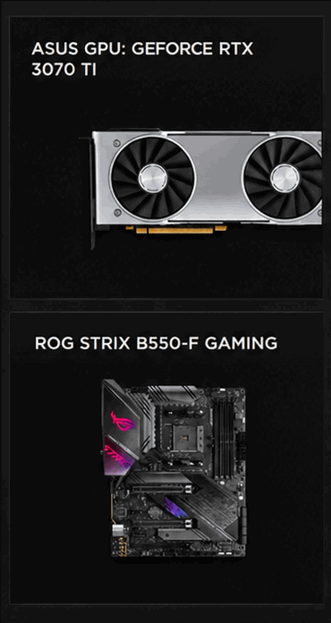
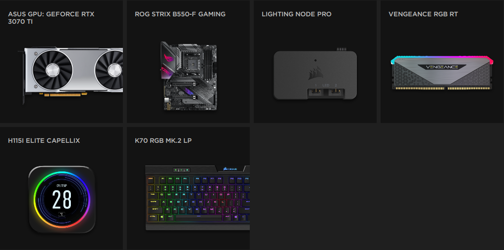
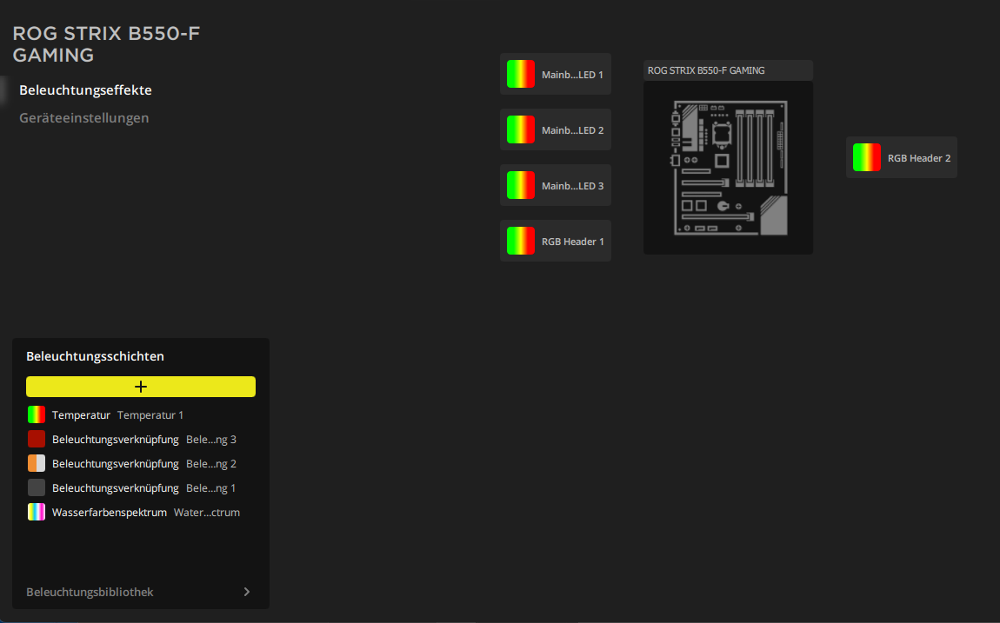
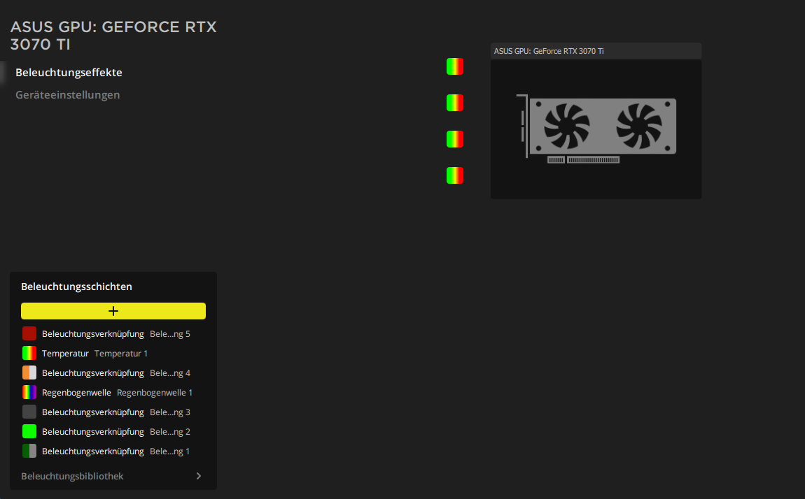

# IcueAuraBridge <a href="README.en.md"></a><a href="README.md"></a>

**Bring ASUS mainboards and graphics cards into iCUE, without Armoury Crate. That easy.**

<p align="center"> <a href="https://github.com/Hendrik4K/IcueAuraBridge/releases/latest"></a>   <a href="LICENSE"></a></p>

<p align="center"> </p>

iCUE already ships an ASUS plugin, but it expects Armoury Crate running in the background. IcueAuraBridge is that one missing piece: a small DLL that presents itself to iCUE as the ASUS Aura SDK and drives the hardware directly over USB and the NVIDIA driver. No extra app, no tray icon, no background service and no ASUS software. Mainboard and graphics card show up as regular tiles in iCUE and sync with your Corsair devices.

> **Beta.** Tested so far with ROG STRIX B550-F GAMING + ASUS TUF RTX 3070 Ti. Reports from other boards and cards are very welcome: just open an issue with your `bridge.log`.

<details>
<summary><b>🚀 Quick start</b></summary>

1. **Check your hardware** (see **Requirements**).
2. **Remove Armoury Crate** with ASUS' *Armoury Crate Uninstall Tool* from the ASUS support site, then reboot. Armoury Crate and ASUS LightingService register the same interface as the bridge, so they can't be installed at the same time.
3. **Download `IcueAuraBridge-<version>.zip`** under **Releases** (on the right) and **extract it**. Don't run the script from inside the zip.
4. **Run `install.ps1`**: right-click → **Run with PowerShell**, or from a terminal in that folder:

   ```powershell
   powershell -ExecutionPolicy Bypass -File .\install.ps1
   ```

   Confirm the admin prompt. A second window runs briefly, then you should see:

   ```
   IcueAuraBridge: stopping iCUE and its plugin host
   IcueAuraBridge: installed 1.0.0.0 to C:\Program Files\IcueAuraBridge\IcueAuraBridge.dll
   IcueAuraBridge: log and settings in C:\ProgramData\IcueAuraBridge
   IcueAuraBridge: starting iCUE again
   ```

5. **iCUE restarts by itself.** After a few seconds the home screen shows the mainboard under its model name and the graphics card as **ASUS GPU: …**.
6. **Click a tile → Lighting Effects.** Every LED can be controlled on its own with all of iCUE's lighting layers: effects, lighting links with your Corsair devices, temperature colours, Murals. Done.

**Feeling laid-back?** Just hand this prompt to your AI agent (e.g. Claude Code or Codex on your PC). It checks your hardware, finds Armoury Crate leftovers and asks you before changing anything.

```text
Help me set up IcueAuraBridge (github.com/Hendrik4K/IcueAuraBridge) on this Windows PC so that Corsair iCUE controls the RGB lighting of my ASUS mainboard and/or ASUS graphics card, without Armoury Crate.
Only check first, and ask me before every change:
1. Windows 10/11 64-bit and Corsair iCUE 4 installed (service `iCUEDevicePluginHost`, folder `plugins\ASUS` in the iCUE directory)?
2. Mainboard: is there an "AURA LED Controller" with VID_0B05 and PID 18F3, 1939, 19AF, 1AA6 or 1BED (`Get-PnpDevice -PresentOnly`)?
3. Graphics card: read the PNPDeviceID (`Get-CimInstance Win32_VideoController`) and match the device ID and ASUS subsystem against `src/GpuList.cs` in the repo. Tell me which of my hardware is supported.
4. Is Armoury Crate or ASUS LightingService installed, or `aura.sdk.1` already registered? If so, explain how I remove it with ASUS' "Armoury Crate Uninstall Tool". Don't uninstall anything yourself.
5. Download the zip from the latest GitHub release, extract it to its own folder, briefly summarize what `install.ps1` does and only run it after my OK. I'll confirm the admin prompt myself.
6. Afterwards read `C:\ProgramData\IcueAuraBridge\bridge.log` and tell me which devices were found and where I find them in iCUE.
7. Ask me whether LED strips or fans are connected to the mainboard's ARGB headers. If so, after my OK enter the LED count in `C:\ProgramData\IcueAuraBridge\config.ini` (e.g. `argb_header_1_leds = 30`) and restart iCUE.
```

**Uninstall:**

```powershell
powershell -ExecutionPolicy Bypass -File .\install.ps1 -Uninstall
```

Removes the DLL and the registration and restarts iCUE. `C:\ProgramData\IcueAuraBridge` (settings and log) is left for you to delete.

</details>

<details>
<summary><b>💡 What it does</b></summary>

- **ASUS RGB right inside iCUE**<br>Mainboard and graphics card appear as devices of their own next to your Corsair hardware.
- **Every LED on its own**<br>Onboard LEDs, both 12 V RGB headers and the graphics card's LEDs, each with all of iCUE's lighting layers.
- **Sync with Corsair**<br>Lighting links keep everything in step, including temperature colours and Murals.
- **No second RGB stack**<br>No Armoury Crate, no OpenRGB or SignalRGB fighting iCUE over the same hardware.
- **Invisible**<br>No app, no tray icon, no service. Just a DLL that iCUE loads when it needs it. iCUE updates don't break it, because no iCUE files are modified.
- **ARGB headers (optional)**<br>Strips and fans on the 5 V ARGB headers can be enabled by setting their LED count in `config.ini` (untested so far, feedback welcome).

<ins>Why this exists:</ins> If you run iCUE with an ASUS board, the usual answers are "just install Armoury Crate too" or "use OpenRGB instead of iCUE". Both mean two RGB programs fighting over the same hardware. Yet iCUE has had an ASUS integration all along; it only lacks the one ASUS interface that Armoury Crate would install. This project provides exactly that interface and nothing else.

</details>

<details>
<summary><b>📷 More pictures</b></summary>

<p align="center"> </p>

<p align="center"><em>Left: the mainboard with 3 onboard LEDs and both 12 V RGB headers. Right: the graphics card with 4 LEDs.</em></p>

</details>

<details>
<summary><b>🧰 Requirements</b></summary>

| | Requirement | Tested on |
|---|---|---|
| Mainboard | ASUS board with the USB "AURA LED Controller" (VID `0B05`, PID `18F3`, `1939`, `19AF`, `1AA6` or `1BED`). Most ASUS AMD/Intel boards from the X570 generation on. | ROG STRIX B550-F GAMING (`1939`, firmware `AULA3-AR42-0222`) |
| Graphics card | ASUS GeForce RTX 30/40/50 card with an ENE RGB controller, one of the 149 models in [`src/GpuList.cs`](src/GpuList.cs) | TUF Gaming RTX 3070 Ti V2 OC (`2482` / `1043:8812`) |

Also:

- Windows 10/11, 64-bit
- Corsair iCUE 4 (tested with 4.33.138)
- For graphics cards: the regular NVIDIA driver (provides `nvapi64.dll`)
- Armoury Crate / ASUS LightingService must **not** be installed

AMD graphics cards, DRAM lighting and ASUS peripherals are not supported.

**Check your hardware** in PowerShell:

```powershell
Get-PnpDevice -PresentOnly | Where-Object InstanceId -match 'VID_0B05' | Select-Object FriendlyName, InstanceId
Get-CimInstance Win32_VideoController | Select-Object Name, PNPDeviceID
```

- **Mainboard:** the first command should list an **AURA LED Controller** whose ID contains `PID_18F3`, `PID_1939`, `PID_19AF`, `PID_1AA6` or `PID_1BED`.
- **Graphics card:** `PNPDeviceID` looks like `PCI\VEN_10DE&DEV_2482&SUBSYS_88121043…`. `DEV_2482` is the card, and `SUBSYS_8812` + `1043` is the ASUS model. Look up the pair (`0x2482…8812`) in [`src/GpuList.cs`](src/GpuList.cs).

If only one of the two matches, that's fine: the bridge uses whatever it finds.

</details>

<details>
<summary><b>⚙️ Settings and troubleshooting</b></summary>

**Settings** in `C:\ProgramData\IcueAuraBridge\config.ini` (open as admin, restart iCUE after changes):

```ini
motherboard = true          # expose the mainboard's onboard LEDs and 12 V RGB headers
gpu = true                  # expose the graphics card
argb_header_1_leds = 0      # LEDs connected to ARGB header 1 (0 = header hidden); also _2_, _3_ ...
gpu_allow_unlisted = false  # also probe ASUS cards that are not in GpuList.cs (at your own risk)
```

The LED count of ARGB headers cannot be read from the hardware, so set it to the number of LEDs on the strip/fans connected there.

**Troubleshooting** with `C:\ProgramData\IcueAuraBridge\bridge.log`:

| Log | Meaning |
|---|---|
| no log at all | iCUE's ASUS plugin never created the bridge: check that the installer ran and that iCUE was restarted |
| `AuraSdk created …` but `0 device(s)` | no supported hardware found; the lines before it say why (e.g. GPU not on the list) |
| `frame written …` | everything works; iCUE is sending colors |

iCUE's own log (`%LOCALAPPDATA%\Corsair\CUE4\logs`) shows what the ASUS plugin does. When you open an issue, please attach `bridge.log`.

**What the installer touches:**

- `C:\Program Files\IcueAuraBridge\IcueAuraBridge.dll`
- COM registration `aura.sdk.1` / CLSID `{05921124-5057-483E-A037-E9497B523590}` in `HKLM\SOFTWARE\Classes`
- `C:\ProgramData\IcueAuraBridge\` for `config.ini` and `bridge.log`

</details>

<details>
<summary><b>⚡ Technology and safety</b></summary>

```
iCUE ─▶ plugins\ASUS\asus_plugin.dll (by Corsair, signed)
          │  CoCreateInstance("aura.sdk.1")
          ▼
        IcueAuraBridge.dll  (implements AuraServiceLib: IAuraSdk2, IAuraSyncDevice, IAuraRgbLight …)
          ├─▶ HID  ─▶ AURA LED Controller (mainboard)
          └─▶ NVAPI I2C ─▶ ENE controller at 0x67 (graphics card)
```

- **The interface:** The interface IDs come from ASUS' public Aura SDK documentation. The method order (vtable layout) is not fully documented, so it was taken from the call sites in `asus_plugin.dll` 1.2.4 and is listed in [`src/AuraInterfaces.cs`](src/AuraInterfaces.cs).
- **Threading:** iCUE calls `Apply()` from its lighting loop. The bridge only queues the frame; a background thread writes it to the hardware (mainboard < 1 ms, GPU ≈ 5 ms per frame), skips unchanged frames, refreshes every 5 s and re-enters direct mode after errors or sleep/resume.
- **Safety:** During detection the mainboard only receives read commands (firmware, config table). Graphics cards are only probed when their PCI IDs are on the known list, and the ENE controller is identified by its read-only signature before anything is written.

**Known limitations**

- **Device images can't be changed.** iCUE checks the plugin's images against SHA-256 hashes stored in the signed plugin. The tiles therefore show the generic pictures that come with iCUE.
- Only direct per-LED control (what iCUE needs). Hardware effects are not exposed.
- Tested with iCUE 4 only.

**Build it yourself (for tinkerers):** No Visual Studio needed. The C# compiler of .NET Framework 4 is part of Windows:

```powershell
.\build.ps1            # -> bin\IcueAuraBridge.dll
.\build.ps1 -Package   # -> dist\IcueAuraBridge-<version>.zip
```

`test\` contains Python scripts used during development: `probe_hw.py` (read-only hardware probe) and `hardware_test.py` (drives the hardware through the COM interface exactly like iCUE's plugin; needs the DLL registered).

</details>

## Credits and license

The USB and I2C protocol details, the NVAPI I2C usage and the list of supported graphics cards come from the [OpenRGB](https://gitlab.com/CalcProgrammer1/OpenRGB) project. Huge thanks to everyone who reverse-engineered these controllers. Interface IDs from the [ASUS Aura SDK documentation](https://www.asus.com/microsite/aurareadydevportal/).

GPL-2.0, see [LICENSE](LICENSE). Corsair, iCUE, ASUS, ROG, TUF, Aura and Armoury Crate are trademarks of their respective owners. IcueAuraBridge is a private hobby project and is not affiliated with, endorsed by, or supported by Corsair or ASUS. Use at your own risk.
