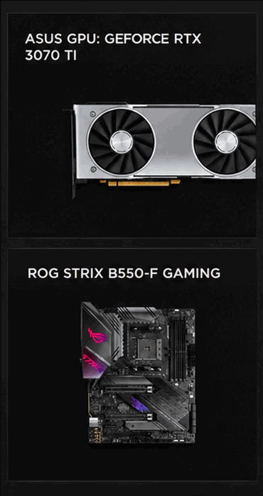
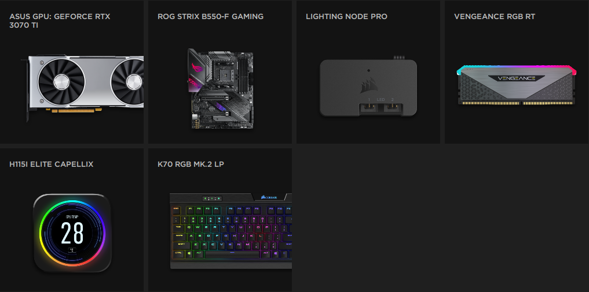
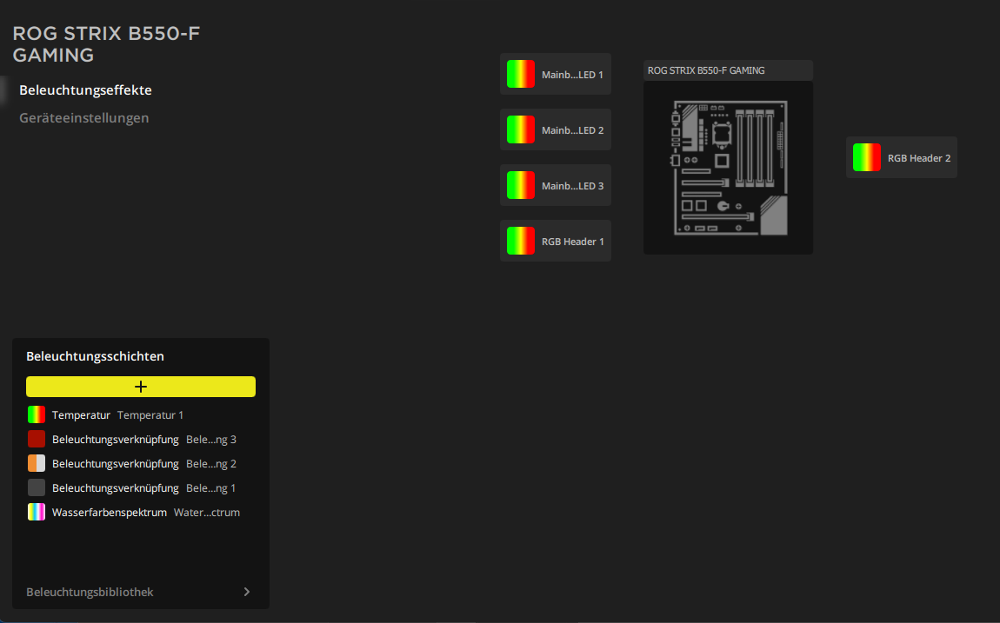
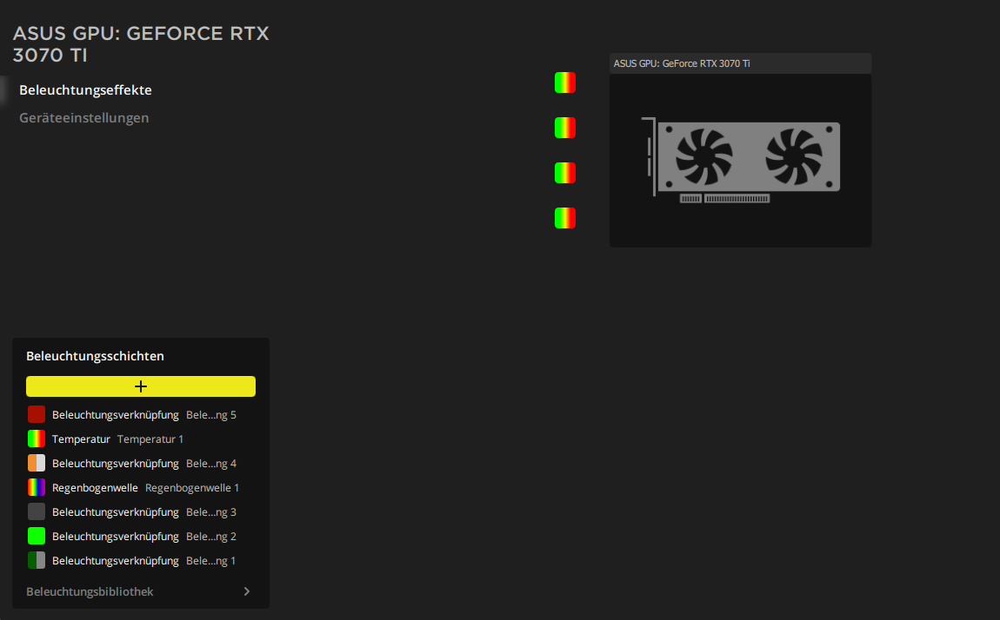

# IcueAuraBridge

**Control the RGB of ASUS mainboards and ASUS GeForce cards from Corsair iCUE, without Armoury Crate.**

iCUE 4 already ships an ASUS plugin, but it only works when ASUS' Aura software
(Armoury Crate / LightingService) is installed. IcueAuraBridge replaces that one missing
piece: a small DLL that implements the ASUS Aura SDK interface iCUE's plugin talks to, and
drives the hardware directly over USB and the NVIDIA driver. No extra app, no tray icon,
no background service, and no ASUS software.

> **Beta.** Tested on one setup so far (ROG STRIX B550-F GAMING + ASUS TUF RTX 3070 Ti).
> Reports from other boards and cards are very welcome: please open an issue with your `bridge.log`.
>
> Not affiliated with, endorsed by, or supported by Corsair or ASUS. Use at your own risk.





*Mainboard and graphics card as regular devices in iCUE, next to Corsair hardware. The tile
pictures are the generic ones that ship with iCUE's ASUS plugin (see limitations).*

**Quick start:** check your hardware, uninstall Armoury Crate, download the
[latest release](https://github.com/Hendrik4K/IcueAuraBridge/releases/latest), run
`install.ps1`. Details in the [step-by-step guide](#step-by-step-guide).

## Background

If you run Corsair iCUE and have an ASUS mainboard or ASUS graphics card, the usual answers
to "how do I sync the ASUS RGB with iCUE?" are: install Armoury Crate next to iCUE, or replace
iCUE's lighting with OpenRGB/SignalRGB. Both mean a second RGB stack fighting over the same
hardware. It turns out iCUE has had an ASUS integration all along. It just needs the one ASUS
COM interface that Armoury Crate would install. This project provides exactly that
interface and nothing else.

## Supported hardware

| | Requirement | Tested on |
|---|---|---|
| Mainboard | ASUS board with the USB "AURA LED Controller" (VID `0B05`, PID `18F3`, `1939`, `19AF`, `1AA6` or `1BED`). Most ASUS AMD/Intel boards from the X570 generation on. | ROG STRIX B550-F GAMING (`1939`, firmware `AULA3-AR42-0222`) |
| Graphics card | ASUS GeForce RTX 30/40/50 card with an ENE RGB controller, one of the 149 models in [`src/GpuList.cs`](src/GpuList.cs) | TUF Gaming RTX 3070 Ti V2 OC (`2482` / `1043:8812`) |

Other requirements:

- Windows 10/11, 64-bit
- Corsair iCUE 4 (tested with 4.33.138)
- For graphics cards: the regular NVIDIA driver (provides `nvapi64.dll`)
- Armoury Crate / ASUS LightingService must **not** be installed: both register the same interface

AMD graphics cards, DRAM lighting and ASUS peripherals are not supported.

## Step-by-step guide

### 1. Check your hardware

Open PowerShell and run:

```powershell
Get-PnpDevice -PresentOnly | Where-Object InstanceId -match 'VID_0B05' | Select-Object FriendlyName, InstanceId
Get-CimInstance Win32_VideoController | Select-Object Name, PNPDeviceID
```

- **Mainboard:** the first command should list an **AURA LED Controller** whose ID contains
  `PID_18F3`, `PID_1939`, `PID_19AF`, `PID_1AA6` or `PID_1BED`.
- **Graphics card:** in the second command's output, `PNPDeviceID` looks like
  `PCI\VEN_10DE&DEV_2482&SUBSYS_88121043…`. `DEV_2482` is the card, and `SUBSYS_8812` + `1043`
  is the ASUS model. Look up the pair (`0x2482…8812`) in [`src/GpuList.cs`](src/GpuList.cs).

If only one of the two matches, that's fine: the bridge uses whatever it finds.

### 2. Remove Armoury Crate

Armoury Crate and ASUS LightingService register the same interface as this bridge, so they
can't be installed at the same time. Uninstall Armoury Crate with ASUS' *Armoury Crate
Uninstall Tool* (from ASUS' support site) and reboot. The installer refuses to continue while
Armoury Crate's interface is still registered.

### 3. Download

Download `IcueAuraBridge-<version>.zip` from the
[latest release](https://github.com/Hendrik4K/IcueAuraBridge/releases/latest) and **extract
it** to a folder. Don't run the script from inside the zip.

### 4. Install

Right-click `install.ps1` → **Run with PowerShell**, or from a terminal in that folder:

```powershell
powershell -ExecutionPolicy Bypass -File .\install.ps1
```

Confirm the admin prompt (Windows may also ask once whether to run a downloaded script). A
second window runs briefly, then you should see:

```
IcueAuraBridge: stopping iCUE and its plugin host
IcueAuraBridge: installed 1.0.0.0 to C:\Program Files\IcueAuraBridge\IcueAuraBridge.dll
IcueAuraBridge: log and settings in C:\ProgramData\IcueAuraBridge
IcueAuraBridge: starting iCUE again
```

### 5. Find the devices in iCUE

iCUE restarts by itself. After a few seconds the home screen shows new tiles: the mainboard
under its model name and the graphics card as **ASUS GPU: …** (see the screenshot at the top).

### 6. Set up the lighting

Click a tile → **Lighting Effects**. Every LED appears on its own and works with all of iCUE's
lighting layers: effects, lighting links to sync with your Corsair devices, temperature
colours, Murals.

| Mainboard: 3 onboard LEDs and both 12 V RGB headers | Graphics card: 4 LEDs |
|---|---|
|  |  |

### 7. Optional: ARGB headers

LEDs on the mainboard's ARGB (5 V, 3-pin) headers can't be counted by the hardware, so they
are hidden until you tell the bridge how many there are. Open
`C:\ProgramData\IcueAuraBridge\config.ini` as admin, set e.g. `argb_header_1_leds = 30`
and restart iCUE. The header then shows up as its own LED strip device. This part is
**untested** so far (the author's header is empty), so feedback is especially welcome. See
[Settings](#settings) for all options.

### If something doesn't show up

Open `C:\ProgramData\IcueAuraBridge\bridge.log` and see [Troubleshooting](#troubleshooting).
When you open an issue, attach that file.

### Uninstall

```powershell
powershell -ExecutionPolicy Bypass -File .\install.ps1 -Uninstall
```

This removes the DLL and the registration and restarts iCUE. `C:\ProgramData\IcueAuraBridge`
(settings and log) is left for you to delete.

### What the installer touches

- `C:\Program Files\IcueAuraBridge\IcueAuraBridge.dll`
- COM registration `aura.sdk.1` / CLSID `{05921124-5057-483E-A037-E9497B523590}` in `HKLM\SOFTWARE\Classes`
- `C:\ProgramData\IcueAuraBridge\` for `config.ini` and `bridge.log`

No iCUE files are modified, so iCUE updates don't break or remove it.

## Settings

`C:\ProgramData\IcueAuraBridge\config.ini` (restart iCUE after changes):

```ini
motherboard = true          # expose the mainboard's onboard LEDs and 12 V RGB headers
gpu = true                  # expose the graphics card
argb_header_1_leds = 0      # LEDs connected to ARGB header 1 (0 = header hidden); also _2_, _3_ ...
gpu_allow_unlisted = false  # also probe ASUS cards that are not in GpuList.cs (at your own risk)
```

The LED count of ARGB headers cannot be read from the hardware, so set it to the number of
LEDs on the strip/fans connected there.

## How it works

```
iCUE ─▶ plugins\ASUS\asus_plugin.dll (by Corsair, signed)
          │  CoCreateInstance("aura.sdk.1")
          ▼
        IcueAuraBridge.dll  (implements AuraServiceLib: IAuraSdk2, IAuraSyncDevice, IAuraRgbLight …)
          ├─▶ HID  ─▶ AURA LED Controller (mainboard)
          └─▶ NVAPI I2C ─▶ ENE controller at 0x67 (graphics card)
```

- **The interface.** The interface IDs come from ASUS' public Aura SDK documentation. The
  method order (vtable layout) is not fully documented, so it was taken from the call sites
  in `asus_plugin.dll` 1.2.4 and is listed in [`src/AuraInterfaces.cs`](src/AuraInterfaces.cs).
- **Threading.** iCUE calls `Apply()` from its lighting loop. The bridge only queues the
  frame; a background thread writes it to the hardware (mainboard < 1 ms, GPU ≈ 5 ms per
  frame), skips unchanged frames, refreshes every 5 s and re-enters direct mode after errors or
  sleep/resume.
- **Safety.** During detection the mainboard only receives read commands (firmware, config
  table). Graphics cards are only probed when their PCI IDs are on the known list, and the
  ENE controller is identified by its read-only signature before anything is written.

## Troubleshooting

Look at `C:\ProgramData\IcueAuraBridge\bridge.log`:

| Log | Meaning |
|---|---|
| no log at all | iCUE's ASUS plugin never created the bridge: check that the installer ran and that iCUE was restarted |
| `AuraSdk created …` but `0 device(s)` | no supported hardware found; the lines before it say why (e.g. GPU not on the list) |
| `frame written …` | everything works; iCUE is sending colors |

iCUE's own log (`%LOCALAPPDATA%\Corsair\CUE4\logs`) shows what the ASUS plugin does.

## Known limitations

- **Device images can't be changed.** iCUE checks the plugin's images against SHA-256 hashes
  stored in the signed plugin and shows an empty tile if a file is modified. The tiles show the
  generic pictures that come with iCUE.
- Only direct per-LED control (what iCUE needs). Hardware effects are not exposed.
- Tested with iCUE 4 only.

## Build from source

No Visual Studio needed. The C# compiler of .NET Framework 4 is part of Windows:

```powershell
.\build.ps1            # -> bin\IcueAuraBridge.dll
.\build.ps1 -Package   # -> dist\IcueAuraBridge-<version>.zip
```

`test\` contains Python scripts used during development: `probe_hw.py` (read-only hardware
probe) and `hardware_test.py` (drives the hardware through the COM interface exactly like
iCUE's plugin; needs the DLL registered).

## Credits

- The USB and I2C protocol details, the NVAPI I2C usage and the list of supported graphics
  cards come from the [OpenRGB](https://gitlab.com/CalcProgrammer1/OpenRGB) project. Huge
  thanks to everyone who reverse-engineered these controllers.
- Interface IDs from the [ASUS Aura SDK documentation](https://www.asus.com/microsite/aurareadydevportal/).

## License

GPL-2.0, see [LICENSE](LICENSE). Corsair, iCUE, ASUS, ROG, TUF, Aura and Armoury Crate are
trademarks of their respective owners.

---

## Deutsch (Kurzfassung)

IcueAuraBridge lässt Corsair iCUE die RGB-Beleuchtung von ASUS-Mainboards und ASUS-GeForce-Karten
steuern, ohne Armoury Crate. iCUE bringt schon ein ASUS-Plugin mit, das aber die ASUS-Software
voraussetzt. Diese DLL ersetzt genau diese fehlende Schnittstelle und steuert die Hardware
direkt über USB bzw. den NVIDIA-Treiber.

**Schritt für Schritt:**

1. **Hardware prüfen:** Im Geräte-Manager muss ein „AURA LED Controller“ auftauchen (Mainboard)
   und/oder die Grafikkarte in [`src/GpuList.cs`](src/GpuList.cs) stehen (Befehle siehe
   [Schritt 1](#1-check-your-hardware) oben).
2. **Armoury Crate deinstallieren** (mit dem „Armoury Crate Uninstall Tool“ von ASUS), neu starten.
3. **Zip herunterladen** vom [neuesten Release](https://github.com/Hendrik4K/IcueAuraBridge/releases/latest)
   und entpacken.
4. **`install.ps1`** per Rechtsklick → „Mit PowerShell ausführen“, Admin-Abfrage bestätigen.
5. **iCUE startet neu** und zeigt Mainboard und Grafikkarte als eigene Kacheln.
6. **Kachel anklicken → Beleuchtungseffekte:** Jede LED lässt sich einzeln mit allen
   iCUE-Ebenen steuern (Effekte, Beleuchtungsverknüpfung, Temperatur, Murals).
7. **ARGB-Header (optional):** Anzahl der LEDs in `C:\ProgramData\IcueAuraBridge\config.ini`
   eintragen (`argb_header_1_leds = 30`), iCUE neu starten. Noch ungetestet.

Deinstallation mit `install.ps1 -Uninstall`. Probleme? `C:\ProgramData\IcueAuraBridge\bridge.log`
ansehen oder als Issue anhängen.

Beta: bisher getestet mit ROG STRIX B550-F GAMING + ASUS TUF RTX 3070 Ti. Rückmeldungen zu
anderen Boards und Karten gern als Issue mit angehängter `bridge.log`.
